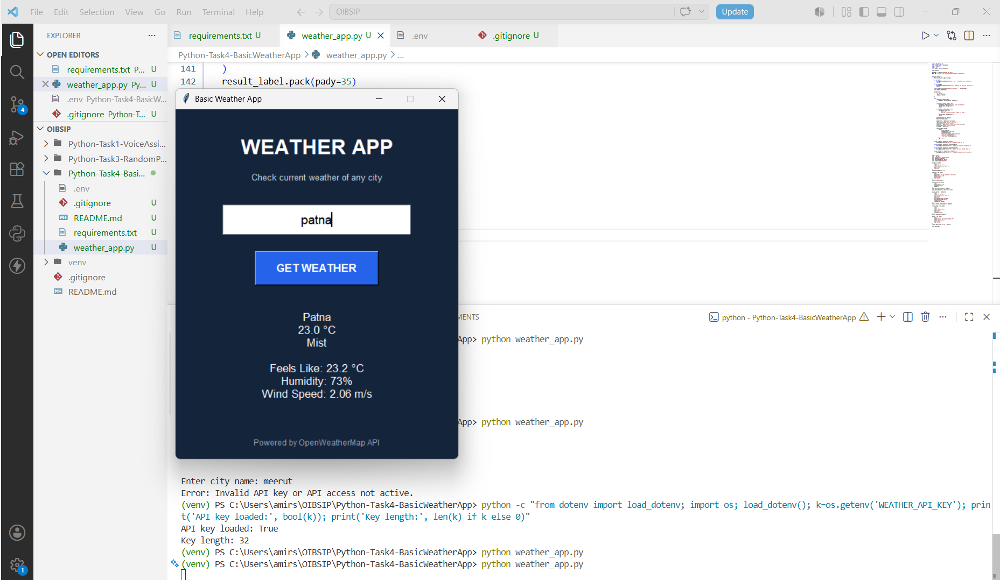
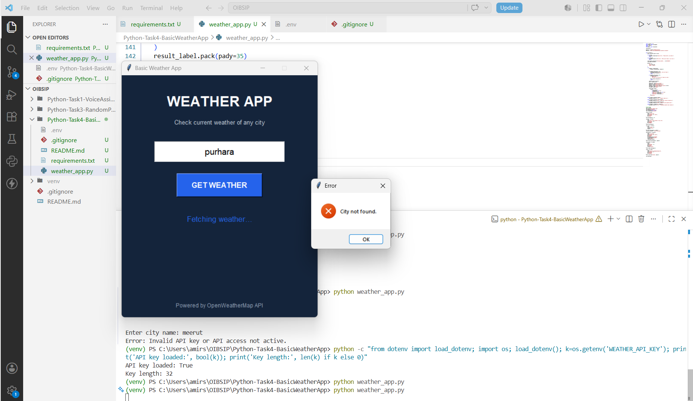
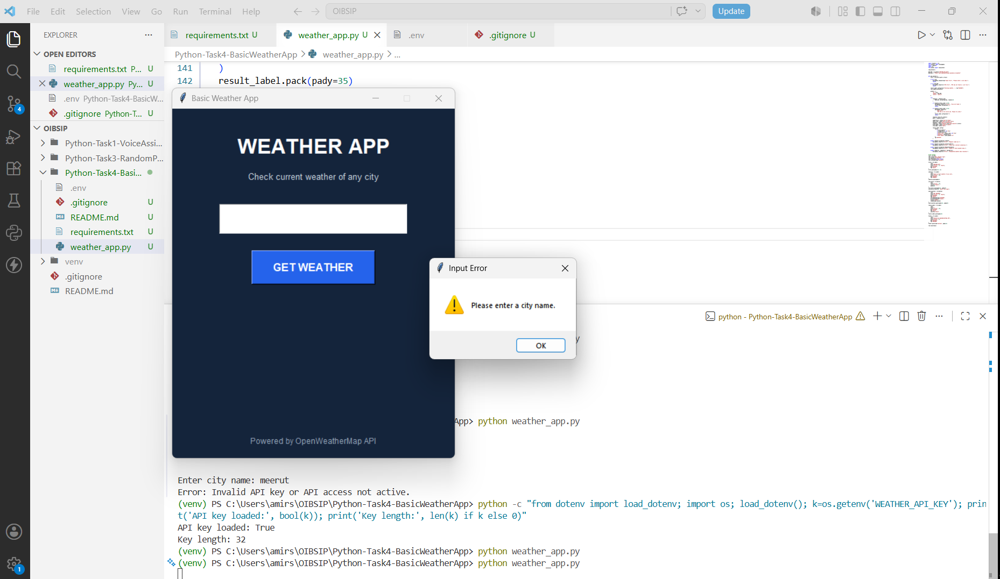

# Basic Weather App | Oasis Infobyte Internship

## Project Overview

The Basic Weather App is a Python-based desktop application that displays real-time weather information for a user-entered city. It uses the OpenWeatherMap API to retrieve current weather data and Tkinter to provide a simple graphical user interface.

## Features

- Search weather by city name.
- Display current temperature in Celsius.
- Display feels-like temperature.
- Show weather conditions.
- Display humidity percentage.
- Display wind speed.
- Handle invalid city names.
- Validate empty input.
- Handle API and network errors.
- Simple and user-friendly GUI.

## Technologies Used

- Python
- Tkinter
- Requests
- Python-dotenv
- OpenWeatherMap API

## Project Structure

```text
Python-Task4-BasicWeatherApp/
│
├── weather_app.py
├── requirements.txt
├── README.md
├── .env
├── .gitignore
└── screenshots/
    ├── 01_successful_weather.png
    ├── 02_invalid_city.png
    └── 03_empty_input.png
```

## Installation and Setup

### 1. Clone the Repository

```bash
git clone https://github.com/Amirkhan786-coder/OIBSIP.git
```

### 2. Navigate to the Project Folder

```bash
cd OIBSIP/Python-Task4-BasicWeatherApp
```

### 3. Create a Virtual Environment

```bash
python -m venv venv
```

Activate it on Windows:

```bash
venv\Scripts\activate
```

### 4. Install Dependencies

```bash
pip install -r requirements.txt
```

### 5. Configure the API Key

Create a `.env` file in the project directory:

```env
WEATHER_API_KEY=your_actual_api_key
```

Get your API key from [OpenWeatherMap](https://openweathermap.org/api).

**Important:** Never upload your API key or `.env` file to GitHub.

### 6. Run the Application

```bash
python weather_app.py
```

## Screenshots

### Successful Weather Result



### Invalid City Handling



### Empty Input Validation



## Learning Outcomes

- Working with external REST APIs.
- Fetching and processing JSON responses.
- Using Python Tkinter for GUI development.
- Managing API keys with environment variables.
- Implementing input validation and exception handling.
- Organizing a Python project.

## Internship

**Organization:** Oasis Infobyte  
**Track:** Python Programming  
**Task:** Task 4 – Basic Weather App

## Author

**Md Amir Khan**

GitHub: https://github.com/Amirkhan786-coder

LinkedIn: https://www.linkedin.com/in/md-amir-khan-91amir35khan/
